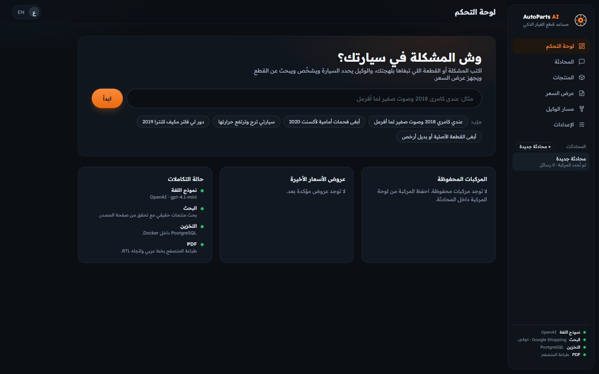
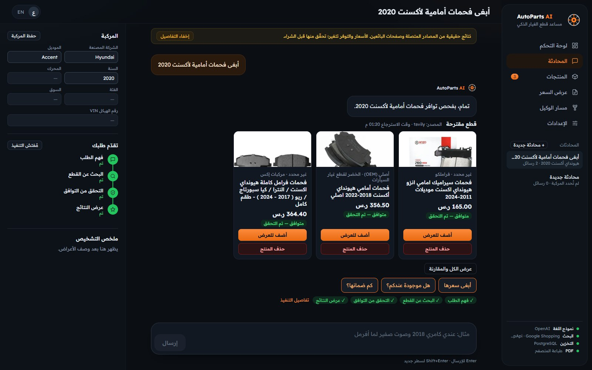
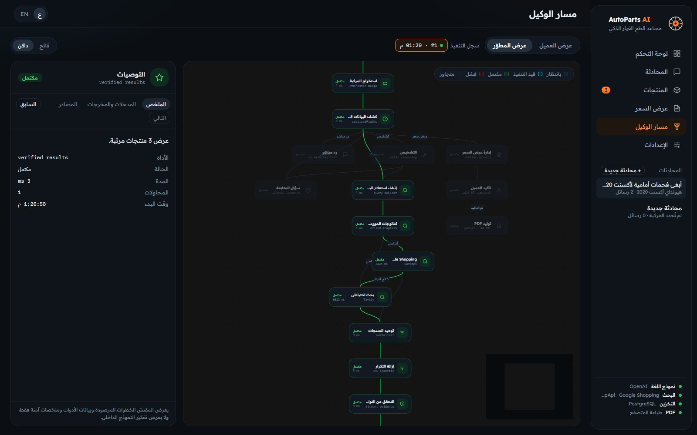
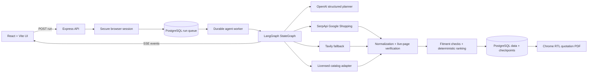

# AutoParts AI

An Arabic-first, production-oriented AI agent for automotive spare-parts discovery in Saudi Arabia.

AutoParts AI understands Saudi dialect, extracts vehicle details, diagnoses likely issues, searches live product sources, verifies fitment and page availability, ranks compatible parts, and prepares an Arabic RTL quotation. The product does not fall back to demo listings or fabricated prices: when a provider is unavailable, the failure is shown explicitly.



## What the Agent Does

- Understands Arabic and English automotive requests, including common Saudi expressions.
- Extracts make, model, year, engine, trim, market, and VIN evidence.
- Produces a structured diagnosis and asks one focused follow-up when essential details are missing.
- Searches Google Shopping through SerpApi, with Tavily as a web-search fallback.
- Supports an optional licensed supplier/OEM catalog adapter.
- Rejects products without explicit make, model, and year-range fitment evidence.
- Opens and validates product pages before showing their links to the customer.
- Extracts real prices, product images, availability, seller, brand, and part numbers.
- Builds quotations and exports Arabic A4 PDFs using headless Chrome.
- Streams every observable agent step to both customer and developer views.
- Keeps every browser session and conversation isolated in PostgreSQL.

## Product Screenshots

### Live product discovery

The agent shows only source-backed listings that survive deterministic relevance, fitment, and page-availability checks.



### Observable LangGraph execution

The developer view exposes executed nodes, timings, retries, safe input/output summaries, and product sources. It never displays private model reasoning.



## Architecture



### Request lifecycle

1. The UI creates a run with `POST /api/agent/runs` and subscribes to its Server-Sent Events stream.
2. A PostgreSQL worker claims the run using `FOR UPDATE SKIP LOCKED`.
3. Conversation history is trimmed and, when necessary, compacted into a rolling summary plus structured facts.
4. OpenAI returns one schema-validated plan containing intent, vehicle evidence, diagnosis, missing information, and search terms.
5. LangGraph chooses only the required route: direct response, follow-up, diagnosis, product search, or quotation.
6. Search results are normalized, deduplicated, opened, checked for availability, and filtered by explicit fitment evidence.
7. Ranked results and execution events are persisted and streamed to the UI.
8. Interrupted queued runs are recovered after a server restart, while SSE clients can reconnect using `Last-Event-ID`.

## Technology Stack

| Area | Tools | Purpose |
| --- | --- | --- |
| Frontend | React 18, TypeScript, Vite | Arabic/English RTL interface and application state |
| Agent visualization | React Flow, Dagre | Customer progress and developer execution graph |
| Backend | Node.js, Express, TypeScript | API, worker, SSE streaming, security middleware |
| Agent orchestration | LangGraph | Conditional workflow, retries, checkpoints, cancellation |
| Language model | OpenAI Chat Completions | Structured intent, extraction, diagnosis, and planning |
| Validation | Zod | Environment, request, provider, and LLM-output schemas |
| Product search | SerpApi, Tavily | Google Shopping primary search and web fallback |
| Data | PostgreSQL 16, `pg` | Sessions, memory, products, quotations, runs, and rate limits |
| Persistence | LangGraph PostgreSQL checkpointer | Conversation-scoped graph checkpoints |
| PDF | Puppeteer Core, Chrome/Chromium | Server-rendered Arabic RTL quotations |
| Testing | Vitest, TypeScript compiler | Unit tests, schema checks, and static validation |
| Local infrastructure | Docker Compose | Reproducible PostgreSQL development service |

## Key Engineering Decisions

### Deterministic compatibility

The model cannot mark a product as compatible. A listing is exposed only when its source-declared title or structured data names the requested make and model and contains a year or year range covering the requested vehicle. Unknown values remain unknown.

### Live-source verification

Before a listing reaches the UI, the backend follows guarded redirects and checks the destination for HTTP errors, soft 404s, unavailable products, and empty product data. DNS and redirect targets are validated to block private-network SSRF.

### Durable memory with bounded context

Each conversation stores a rolling summary, structured facts, and recent verbatim messages. Older turns are compacted only after configurable token or message thresholds. Newer user corrections take precedence, and summaries are treated as untrusted context rather than instructions.

### Visitor data isolation

Each browser receives a random 256-bit `HttpOnly` session token. PostgreSQL stores only its SHA-256 hash. Settings, conversations, vehicles, memory, products, quotations, PDFs, runs, events, and LangGraph checkpoints are scoped to the resulting owner ID. Clearing cookies creates a new empty workspace.

This is anonymous browser isolation, not cross-device account authentication.

## Security and Reliability

- Strict Zod validation for external input and provider responses.
- One controlled schema-repair attempt for malformed model output.
- PostgreSQL-backed per-session and per-IP rate limits.
- Same-origin checks for mutation requests.
- `HttpOnly`, `SameSite=Lax`, and production `Secure` session cookies.
- Security headers and HSTS in production.
- SSRF-safe product-page fetching with DNS and redirect validation.
- Abort propagation from the UI to OpenAI, search providers, and page verification.
- Sanitized client errors in production.
- No API keys are sent to the browser.
- No fixture products, simulated prices, or silent provider fallbacks.

## Prerequisites

- Node.js 20 or newer
- npm
- Docker Desktop or a compatible Docker Engine
- Google Chrome or Chromium for PDF generation and screenshot capture
- An OpenAI API key
- A SerpApi key, a Tavily key, or both

## Quick Start

```bash
npm install
```

Create the backend environment file:

```powershell
Copy-Item backend/.env.example backend/.env
```

On macOS or Linux:

```bash
cp backend/.env.example backend/.env
```

Add at least `OPENAI_API_KEY` and one search-provider key to `backend/.env`, then start PostgreSQL and the application:

```bash
npm run db:up
npm run dev
```

Open [http://127.0.0.1:5173](http://127.0.0.1:5173).

> The backend reads environment variables at startup. Restart `npm run dev` after editing `backend/.env`.

## Environment Variables

| Variable | Required | Description |
| --- | --- | --- |
| `OPENAI_API_KEY` | Yes | Structured Arabic/English planning and diagnosis |
| `OPENAI_MODEL` | No | OpenAI model; defaults to `gpt-4.1-mini` |
| `SERPAPI_API_KEY` | One search key | Primary Google Shopping provider |
| `TAVILY_API_KEY` | One search key | Fallback web-search provider |
| `DATABASE_URL` | Yes | PostgreSQL connection string |
| `AUTHORIZED_CATALOG_URL` | No | HTTPS base URL for a licensed supplier/OEM adapter |
| `AUTHORIZED_CATALOG_API_KEY` | No | Bearer token for the licensed catalog adapter |
| `CONTEXT_TOKEN_BUDGET` | No | Maximum approximate planner-context budget |
| `RECENT_CONTEXT_TOKEN_BUDGET` | No | Budget reserved for recent verbatim messages |
| `SUMMARY_TRIGGER_TOKENS` | No | Token estimate that triggers rolling summarization |
| `SUMMARY_TRIGGER_MESSAGES` | No | Message count that triggers rolling summarization |
| `CHROME_EXECUTABLE_PATH` | No | Chrome/Chromium path; common locations are auto-detected |
| `CHROME_NO_SANDBOX` | No | Disable only in a container that cannot provide a sandbox |
| `FRONTEND_DIST` | No | Production frontend build directory override |
| `HOST` / `PORT` | No | API bind address and port; defaults to `127.0.0.1:8787` |
| `TRUST_PROXY` | No | Number of trusted reverse-proxy hops |
| `NODE_ENV` | No | `development`, `test`, or `production` |

Never commit `backend/.env`. The repository includes only the safe [`backend/.env.example`](backend/.env.example) template.

## Available Commands

| Command | Description |
| --- | --- |
| `npm run dev` | Run the API and Vite development server together |
| `npm run build` | Build the backend and production frontend |
| `npm run typecheck` | Type-check both workspaces |
| `npm test` | Run the backend Vitest suite |
| `npm run db:up` | Start PostgreSQL with Docker Compose |
| `npm run db:down` | Stop PostgreSQL |
| `npm run docs:screenshots` | Rebuild README screenshots from the running local app |

`docs:screenshots` sends the example dashboard request through the configured live providers, so the app and database must already be running and provider usage may be billed.

## Production Build

```bash
npm run build
npm start -w backend
```

For production:

1. Set `NODE_ENV=production`.
2. Use a production PostgreSQL URL; the development database credentials are rejected in production.
3. Run behind HTTPS so the browser-session cookie receives the `Secure` flag.
4. Store provider credentials in a managed secret store.
5. Configure `TRUST_PROXY` to match the actual reverse-proxy topology.

The backend serves the built frontend from `frontend/dist` by default when it exists.

## Verification

The current implementation is validated with:

```bash
npm run typecheck
npm test
npm run build
npm audit
docker compose config --quiet
```

Latest local verification: **35 tests passed**, both workspaces type-checked, the production build completed, and `npm audit` reported no known vulnerabilities.

## Project Structure

```text
.
├── backend/
│   ├── .env.example
│   └── src/
│       ├── config/          Validated environment configuration
│       ├── db/              PostgreSQL pool and idempotent migrations
│       ├── domain/          Automotive catalog vocabulary
│       ├── middleware/      Sessions, rate limits, origin checks, errors
│       ├── repositories/    Owner-scoped persistence
│       ├── routes/          Agent, state, quotation, and PDF APIs
│       └── services/
│           ├── agent/       LangGraph, durable worker, SSE, cancellation
│           ├── catalog/     Optional licensed supplier adapter
│           ├── llm/         OpenAI client, prompt, and plan schema
│           ├── memory/      Summarization and context compaction
│           ├── pdf/         Arabic RTL quotation rendering
│           └── search/      Search, normalization, verification, ranking
├── frontend/
│   └── src/
│       ├── api/             Browser API client
│       ├── app/             Controller and view-model composition
│       ├── components/      Shared layout and UI components
│       ├── domain/          i18n, workflow, compatibility, app state
│       └── pages/           Dashboard, chat, products, quote, graph, settings
├── docs/images/             README screenshots
├── tools/                   Documentation capture utility
├── docker-compose.yml
└── package.json
```

## Optional Authorized Catalog Contract

The licensed adapter calls:

- `POST /v1/parts/search` with `{ vehicle, partTypes }`
- `POST /v1/vehicles/vin` with `{ vin }`

Part results must contain a stable ID, title, seller, URL, part type, and at least one explicit fitment range. VIN responses must return `{ verified, vehicle? }`. Invalid or incomplete responses are rejected and never converted into verified compatibility.

## Known Limitations

- No licensed Saudi supplier or OEM credentials are included.
- VIN verification remains unavailable until the licensed catalog adapter is configured.
- User identity is an anonymous browser session; account login, recovery, and staff roles are outside the current scope.
- OpenAI is intentionally the only LLM provider, so a valid key and network connection are required.
- Search accuracy and latency depend on external providers and merchant-page availability.

## Suggested Demo Flow

1. Ask: `أبغى فحمات أمامية لأكسنت 2020`.
2. Review the verified product cards, prices, images, sellers, and source links.
3. Open **Agent graph** to inspect the executed nodes and timings.
4. Add a priced product to the quotation.
5. Confirm the quotation and export the Arabic RTL PDF.

